<a id="inicio"></a>

<div align="center">

<picture>
  <source media="(prefers-color-scheme: dark)" srcset="docs/readme/banner-dark.svg">
  <source media="(prefers-color-scheme: light)" srcset="docs/readme/banner-light.svg">
  
</picture>

<br>

<a href="https://sijb-bootcamp.vercel.app"></a>
<a href="#ejecutar-en-local"></a>
<a href="docs/DESPLIEGUE.md"></a>

<br>


<br><br>

**Plataforma educativa de [Soluciones Integrales JB S.A.C.](https://sijb-bootcamp.vercel.app)** — *Tu mejor opción tecnológica.*<br>
Cursos en video, progreso real, certificados verificables con código, un asistente propio con IA<br>
y un Libro de Reclamaciones virtual según la normativa peruana. Todo funcionando **gratis, las 24 horas**.

<sub>[Funciones](#funciones) · [Capturas](#capturas) · [JB Assist](#jb-assist) · [Arquitectura](#arquitectura) · [Tecnologías](#tecnologias) · [Instalación](#ejecutar-en-local) · [Despliegue](#despliegue) · [Seguridad](#seguridad) · [Autor](#autor)</sub>

</div>

<br>

<picture>
  <source media="(prefers-color-scheme: dark)" srcset="docs/readme/vitrina-dark.jpg">
  <source media="(prefers-color-scheme: light)" srcset="docs/readme/vitrina-light.jpg">
  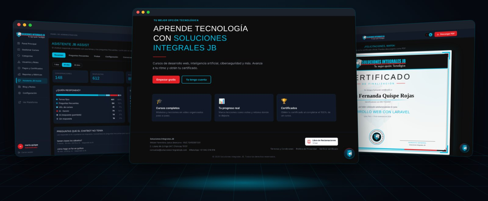
</picture>


## 🎯 ¿Qué es?

**SIJB Bootcamp** es la plataforma web con la que *Soluciones Integrales JB* capacita a su personal y a sus alumnos en desarrollo web, apps móviles con IA, automatización, ciencia de datos y ciberseguridad.

<table>
<tr>
<td align="center" width="25%"><font size="6">🎬</font><br><b>Cursos en video</b><br><sub>Módulos, lecciones, PDF y kits de práctica</sub></td>
<td align="center" width="25%"><font size="6">📈</font><br><b>Progreso real</b><br><sub>Cada lección vista cuenta y el alumno retoma donde se quedó</sub></td>
<td align="center" width="25%"><font size="6">🎓</font><br><b>Certificados</b><br><sub>Constancia gratis y certificado oficial con código único verificable</sub></td>
<td align="center" width="25%"><font size="6">🤖</font><br><b>JB Assist</b><br><sub>Chatbot propio que responde casi todo sin depender de la IA</sub></td>
</tr>
</table>

<a id="funciones"></a>

## ✨ Funciones

<table>
<tr>
<td valign="top" width="50%">

#### 👩‍🎓 Para el alumno
- Registro e inicio de sesión seguro
- Catálogo de cursos por categorías y búsqueda
- Reproductor de lecciones con progreso automático
- **Cuestionarios** al final de cada módulo o después de una lección, con nota al instante y reintentos
- **Examen final** que se desbloquea al 100 % y habilita la constancia
- **Preguntas en cada lección**: el equipo responde y el alumno recibe un aviso
- **Calificación con estrellas y reseñas** de cada curso
- **Notificaciones**: cursos nuevos, respuestas, constancia y certificado listos
- Recursos del curso: **guías en PDF y kits de práctica en ZIP**
- **Constancia gratuita** con nombre y documento al completar el curso y aprobar el examen final
- **Certificado oficial** con foto y documento (pago por WhatsApp)
- Perfil con foto formal comprimida en el navegador
- Modo claro y oscuro, en computadora y celular

</td>
<td valign="top" width="50%">

#### 🛠️ Para el administrador
- Cursos, categorías, módulos y lecciones
- **Cuestionarios** con editor de preguntas, respuesta correcta, explicación y estadísticas (intentos, nota promedio, aprobados)
- **Preguntas y reseñas**: responde dudas por lección (con contador de pendientes) y oculta reseñas inapropiadas
- **Datos para certificados**: lo que cada alumno registró para su constancia, con exportación a Excel
- **Automatizaciones con n8n**: correos y avisos automáticos (guía en [`docs/N8N.md`](docs/N8N.md))
- Usuarios y roles
- **Pagos y certificados**: confirma pagos y libera el certificado
- **Panel de JB Assist**: estadísticas, preguntas sin respuesta, FAQ editables, prueba en vivo y la IA activable o desactivable
- **Libro de Reclamaciones**: lista, plazos y respuesta formal
- Blog, redes sociales, reportes y métricas
- Carga masiva de material: `npm run material:cargar`

</td>
</tr>
<tr>
<td valign="top">

#### ⚖️ Legal (Perú)
- **Libro de Reclamaciones virtual** (D.S. 011-2011-PCM y 101-2022-PCM): código `LR-AAAA-NNNNNN`, plazo de **15 días hábiles** calculado solo y consulta pública del estado
- Términos y condiciones, y política de privacidad (Ley 29733)
- Verificación pública de certificados en `/verificar`

</td>
<td valign="top">

#### 🚀 Calidad web
- Títulos por página, `sitemap.xml`, `robots.txt` y página 404 propia
- Vista previa al compartir en redes (Open Graph)
- Analíticas **sin cookies** (Vercel Web Analytics)
- Imágenes comprimidas antes de subirlas
- Estado del servidor en `GET /health`

</td>
</tr>
</table>

<a id="capturas"></a>

## 📸 Capturas

<table>
<tr>
<td width="50%">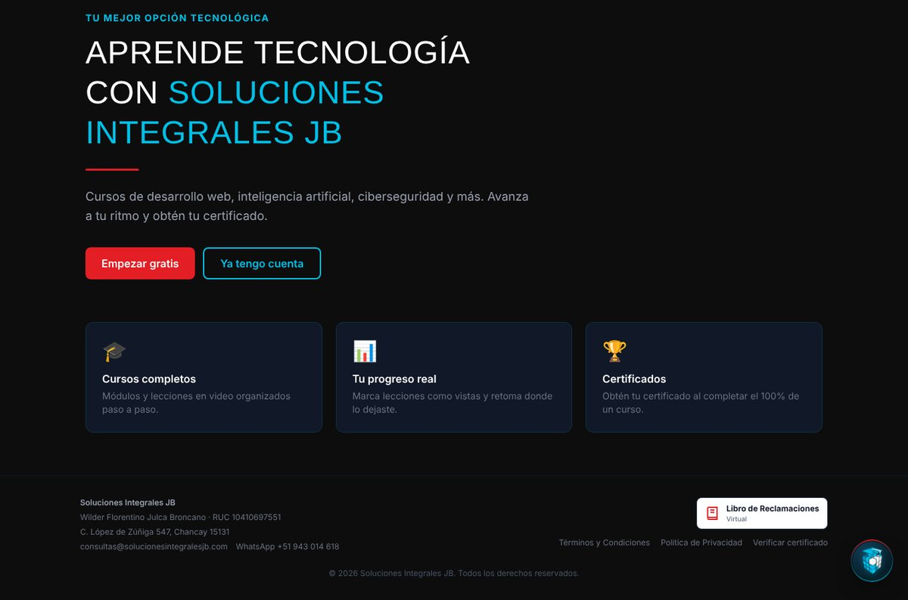<p align="center"><sub><b>Inicio</b>: presentación de la empresa y los cursos</sub></p></td>
<td width="50%">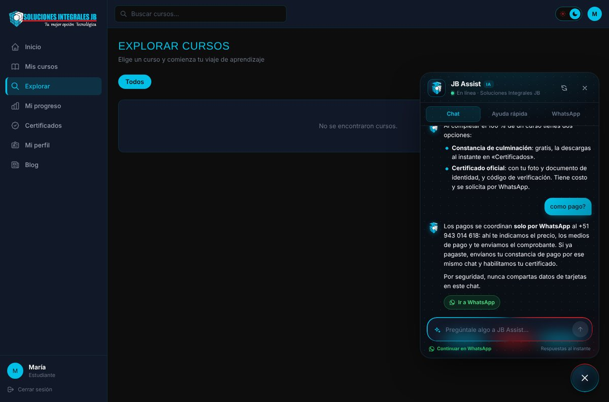<p align="center"><sub><b>JB Assist</b>: respuestas al instante con botones de acción</sub></p></td>
</tr>
<tr>
<td>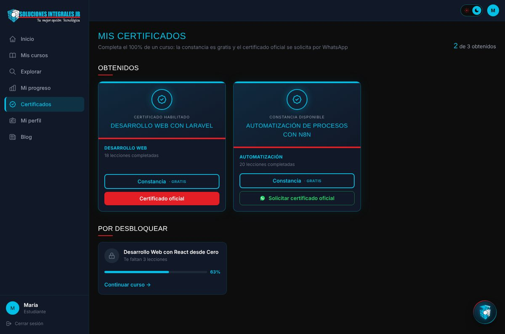<p align="center"><sub><b>Mis certificados</b>: constancias y certificados obtenidos</sub></p></td>
<td>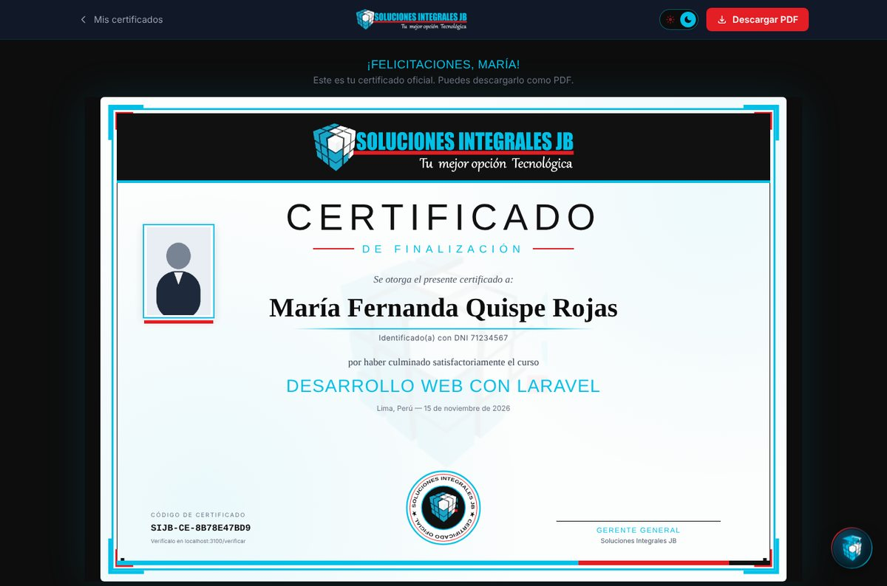<p align="center"><sub><b>Certificado oficial</b>: con foto, documento y código único</sub></p></td>
</tr>
<tr>
<td>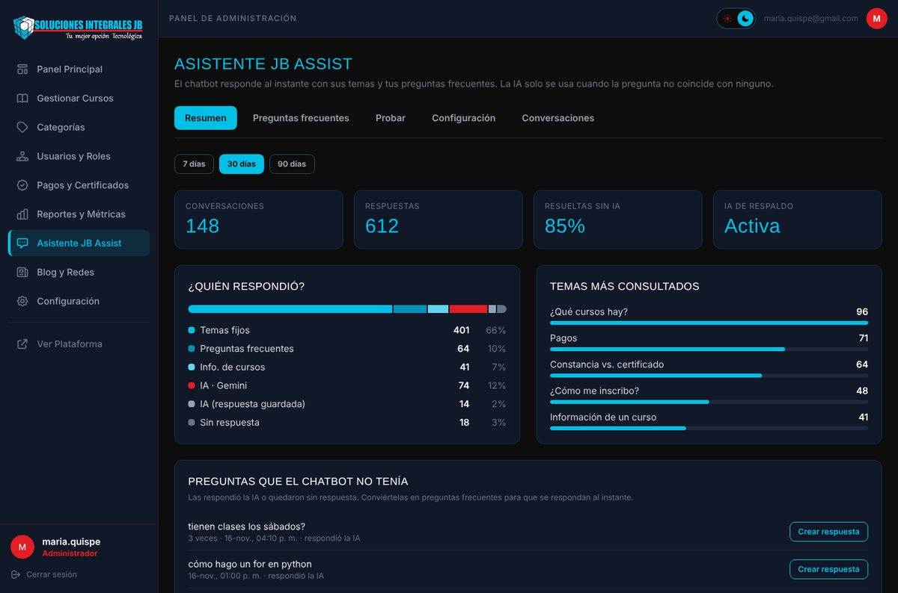<p align="center"><sub><b>Admin · JB Assist</b>: quién respondió y qué preguntan</sub></p></td>
<td>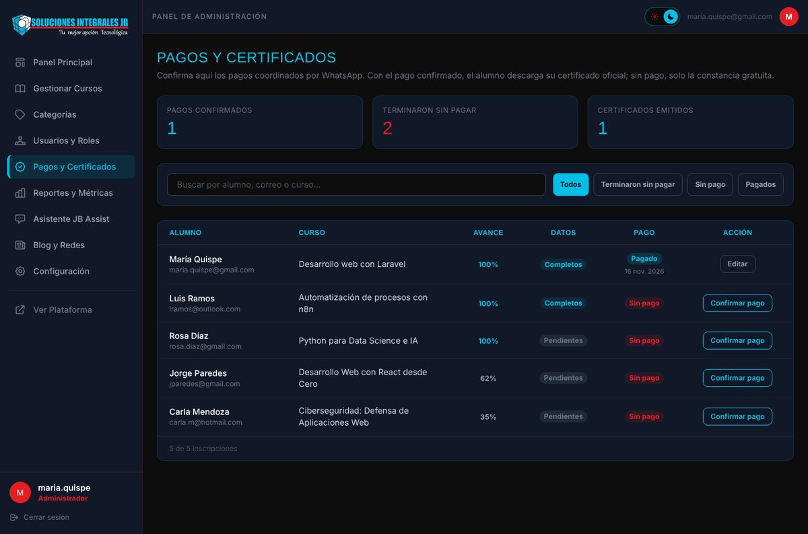<p align="center"><sub><b>Admin · Pagos</b>: confirma pagos y libera certificados</sub></p></td>
</tr>
</table>

<details>
<summary><b>Ver más capturas</b> (verificación, perfil, reclamaciones, bienvenida, 404)</summary>
<br>
<table>
<tr>
<td width="50%">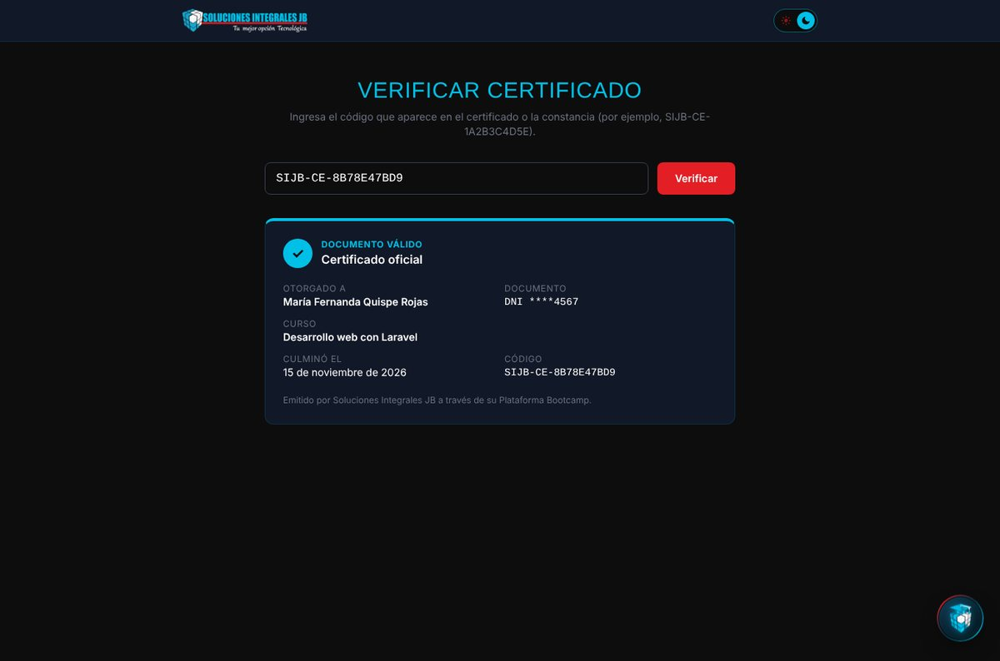<p align="center"><sub><b>Verificación pública</b> de certificados</sub></p></td>
<td width="50%">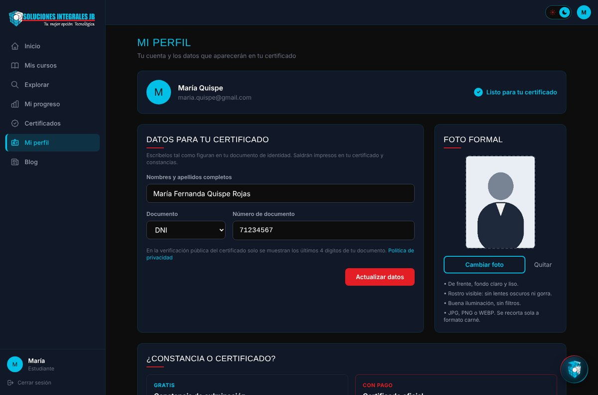<p align="center"><sub><b>Mi perfil</b>: datos y foto para el certificado</sub></p></td>
</tr>
<tr>
<td>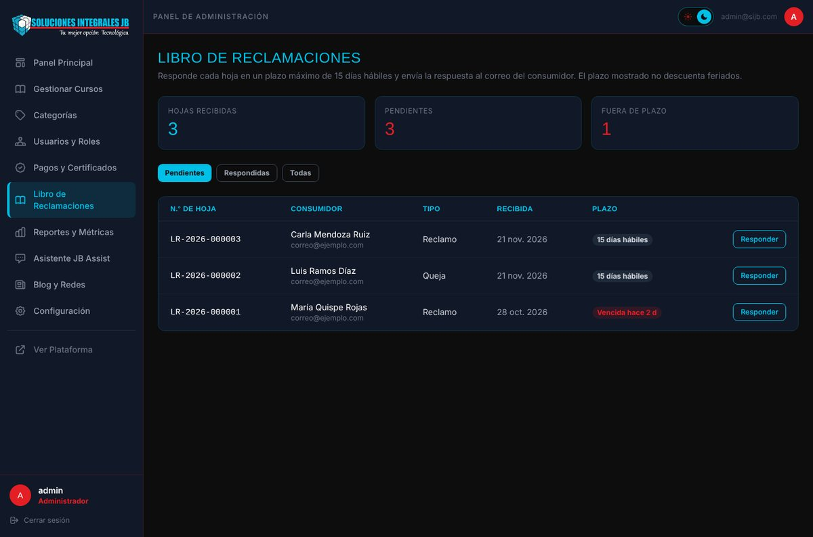<p align="center"><sub><b>Admin · Libro de Reclamaciones</b> con plazos</sub></p></td>
<td>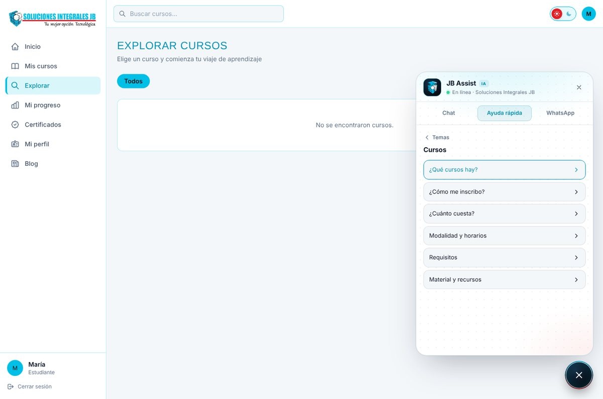<p align="center"><sub><b>JB Assist · Ayuda rápida</b> en modo claro</sub></p></td>
</tr>
<tr>
<td>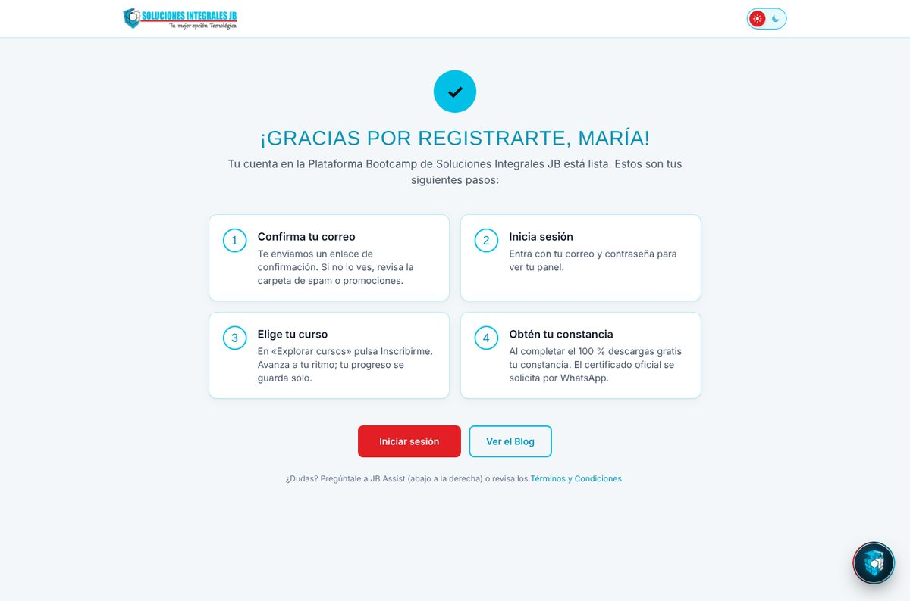<p align="center"><sub><b>Bienvenida</b> después del registro</sub></p></td>
<td>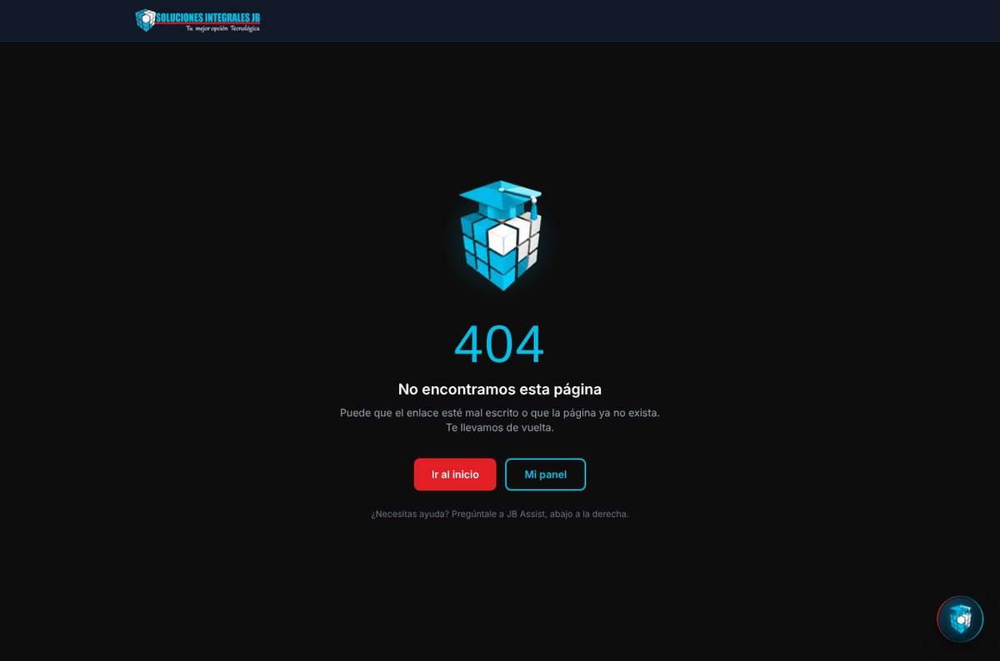<p align="center"><sub><b>Página 404</b> con el cubo de la marca</sub></p></td>
</tr>
</table>
</details>

<a id="jb-assist"></a>

## 🤖 JB Assist: un chatbot que no depende de la IA

La mayoría de los chatbots envían cada mensaje a una IA de pago. **JB Assist tiene su propio motor**: entiende la pregunta con reglas de lenguaje y solo usa la IA cuando de verdad no sabe la respuesta. Así es **rápido, gratis y no se cae** si la IA falla.

<picture>
  <source media="(prefers-color-scheme: dark)" srcset="docs/readme/jbassist-dark.svg">
  <source media="(prefers-color-scheme: light)" srcset="docs/readme/jbassist-light.svg">
  
</picture>

<details>
<summary><b>¿Cómo entiende las preguntas?</b></summary>
<br>

| Técnica | Para qué sirve |
|---|---|
| Normalización | Ignora mayúsculas, tildes y signos: `¿CÓMO PAGO?` = `como pago` |
| Palabras vacías y raíces | Se queda con lo importante: `certificados` → `certific` |
| Tolerancia a errores | Entiende `sertificado` o `contraseña` mal escrita (distancia de Levenshtein, en palabras de 5 letras o más) |
| Puntaje por cobertura | Compara con los ejemplos de cada intención y elige la mejor. Responde con 62 % de seguridad o más; entre 42 % y 62 % pregunta "¿quisiste decir…?" |
| Caché de IA | Una pregunta ya respondida por la IA no vuelve a gastar consultas (12 horas, 300 respuestas) |

El administrador ve **qué capa respondió cada mensaje**, las preguntas que el bot no supo responder y puede convertirlas en FAQ con un clic.

</details>

<a id="arquitectura"></a>

## 🏗️ Arquitectura

<picture>
  <source media="(prefers-color-scheme: dark)" srcset="docs/readme/arquitectura-dark.svg">
  <source media="(prefers-color-scheme: light)" srcset="docs/readme/arquitectura-light.svg">
  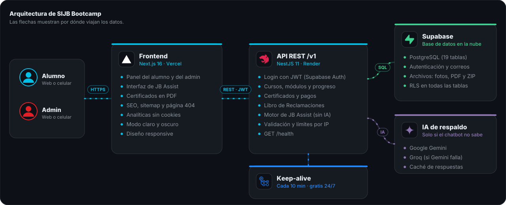
</picture>

<a id="tecnologias"></a>

## 🧰 Tecnologías

<picture>
  <source media="(prefers-color-scheme: dark)" srcset="docs/readme/stack-dark.svg">
  <source media="(prefers-color-scheme: light)" srcset="docs/readme/stack-light.svg">
  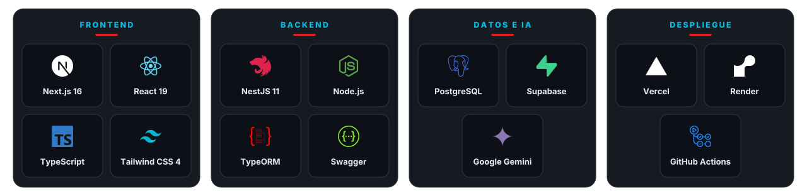
</picture>

## 📁 Estructura del repositorio

```text
bootcamp-platform/
├── bootcamp-frontend/          Next.js 16 · React 19 · Tailwind 4
│   ├── app/                    Páginas: público, alumno (/dashboard, /courses…) y /admin
│   ├── components/             JB Assist, layouts, certificados, formularios
│   ├── hooks/                  Llamadas a la API por módulo
│   └── lib/                    Datos legales, WhatsApp, compresión de imágenes
├── bootcamp-backend/           NestJS 11 · TypeORM · API REST /v1
│   ├── src/
│   │   ├── auth/  users/       Login con Supabase Auth + JWT, roles
│   │   ├── courses/  progress/ Cursos, módulos, lecciones y avance
│   │   ├── certificates/       Constancias, certificados y verificación
│   │   ├── assistant/engine/   Motor propio de JB Assist
│   │   ├── complaints/         Libro de Reclamaciones
│   │   └── health/             GET /health
│   ├── database/schema.sql     Base de datos completa (25 tablas + RLS)
│   └── material-cursos/        Guías PDF y kits ZIP de 7 cursos
├── docs/DESPLIEGUE.md          Guía paso a paso (Vercel + Render + Supabase)
└── render.yaml                 Configuración del backend en Render
```

<a id="ejecutar-en-local"></a>

## 💻 Ejecutar en local

**Requisitos:** Node.js 20 o superior y un proyecto gratuito en [Supabase](https://supabase.com).

```bash
# 1. Clonar
git clone https://github.com/jaredaalarcon-dev/bootcamp-platform.git
cd bootcamp-platform

# 2. Backend  →  http://localhost:3001  (Swagger en /api/docs)
cd bootcamp-backend
cp .env.example .env        # completa los valores
npm install
npm run start:dev

# 3. Frontend  →  http://localhost:3000   (en otra terminal)
cd bootcamp-frontend
cp .env.example .env.local  # completa los valores
npm install
npm run dev
```

> [!TIP]
> ¿Base de datos vacía? Ejecuta `bootcamp-backend/database/schema.sql` en el editor SQL de Supabase y luego `npm run seed` en el backend.

<details>
<summary><b>Variables de entorno</b></summary>
<br>

**Backend** (`bootcamp-backend/.env`)

| Variable | Descripción |
|---|---|
| `NODE_ENV` / `PORT` | Entorno y puerto (por defecto `3001`) |
| `FRONTEND_URL` | URL(s) permitidas por CORS, separadas por coma |
| `DATABASE_URL` | Cadena de conexión de PostgreSQL (Supabase) |
| `SUPABASE_URL` / `SUPABASE_KEY` / `SUPABASE_SERVICE_ROLE_KEY` | Claves del proyecto de Supabase |
| `JWT_SECRET` / `JWT_EXPIRES_IN` | Firma de los tokens de sesión |
| `GEMINI_API_KEY` | IA de respaldo de JB Assist (gratis en Google AI Studio) |
| `GROQ_API_KEY` | *(Opcional)* segunda IA de respaldo |
| `N8N_WEBHOOK_URL` / `N8N_WEBHOOK_SECRET` / `N8N_API_KEY` | *(Opcional)* automatizaciones con n8n ([guía](docs/N8N.md)) |

**Frontend** (`bootcamp-frontend/.env.local`)

| Variable | Descripción |
|---|---|
| `NEXT_PUBLIC_API_URL` | URL del backend, terminando en `/v1` |
| `NEXT_PUBLIC_SITE_URL` | URL pública del sitio, sin `/` al final |

</details>

<details>
<summary><b>Comandos útiles</b></summary>
<br>

| Dónde | Comando | Qué hace |
|---|---|---|
| backend | `npm run start:dev` | Servidor con recarga automática |
| backend | `npm run seed` | Datos iniciales (roles, categorías, cursos) |
| backend | `npm run material:cargar -- --revisar` | Muestra qué material se cargaría a cada curso |
| backend | `npm run material:cargar -- --actualizar` | Sube las guías y kits a los cursos |
| backend | `npm run cuestionarios:cargar -- --revisar` | Muestra qué cuestionarios se crearían en cada curso |
| backend | `npm run cuestionarios:cargar` | Crea los cuestionarios por módulo y el examen final (no duplica) |
| frontend | `npm run build` | Compilación de producción |
| frontend | `npm run build:cpanel` | Paquete listo para un hosting con cPanel |

</details>

<a id="despliegue"></a>

## ☁️ Despliegue gratis 24/7

| Pieza | Servicio | Plan |
|---|---|---|
| Frontend | **Vercel** | Hobby (gratis) |
| Backend | **Render** (`render.yaml`) | Free |
| Base de datos, login y archivos | **Supabase** | Free |
| Mantenerlo despierto | **GitHub Actions** + **cron-job.org** visitan `/health` cada 10 min | Gratis |

Guía completa, paso a paso y con capturas: **[`docs/DESPLIEGUE.md`](docs/DESPLIEGUE.md)**. También incluye cómo pasar a **cPanel** más adelante.

<a id="seguridad"></a>

## 🔒 Seguridad

- **Row Level Security** activado en todas las tablas de Supabase.
- Las claves privadas (service role, JWT, IA) **solo viven en el servidor**; los `.env` nunca se suben al repositorio.
- Fotos y documentos en **almacenamiento privado** con enlaces firmados que vencen.
- Validación de datos en todas las rutas y **límite por IP** en formularios públicos.
- El documento del alumno se muestra **enmascarado** en la verificación pública.
- Swagger desactivado en producción.

<a id="autor"></a>

## 👨‍💻 Autor

<table>
<tr>
<td align="center" width="140">

</td>
<td>

**Jared Alonso Arroyo Alarcón**<br>
Ingeniería de Software con Inteligencia Artificial · SENATI

<a href="https://github.com/jaredaalarcon-dev"></a>
<a href="https://sijb-bootcamp.vercel.app"></a>

</td>
</tr>
</table>

<div align="center">

<picture>
  <source media="(prefers-color-scheme: dark)" srcset="bootcamp-frontend/public/brand/logo-sijb-oscuro.png">
  <source media="(prefers-color-scheme: light)" srcset="bootcamp-frontend/public/brand/logo-sijb-claro.png">
  
</picture>

<sub>© 2026 Soluciones Integrales JB S.A.C. · Chancay, Huaral, Lima · Hecho en Perú 🇵🇪</sub>

<sub>[⬆ Volver arriba](#inicio)</sub>

</div>
